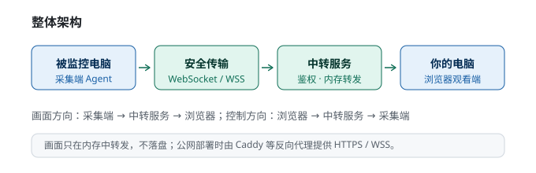
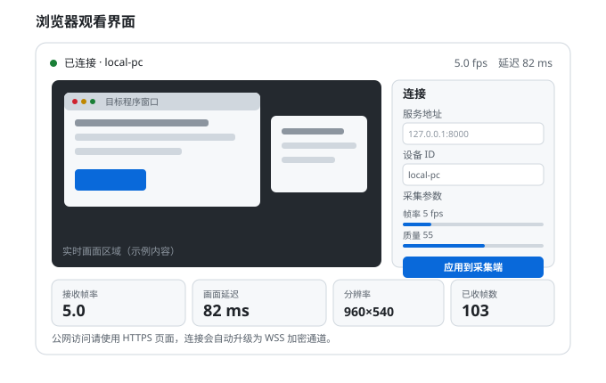
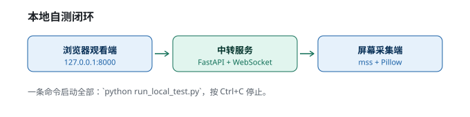

# Remote Monitor

一个轻量级的远程屏幕实时查看原型：Windows 采集端截取屏幕并压缩成 JPEG，通过 WebSocket 推送到中转服务，再由浏览器实时显示。适合远程桌面协助、机房机器自查、自己设备的跨网络查看等场景。

> **使用边界**：请只在自己拥有、或已获得明确授权的设备上运行。采集端启动后会在终端持续显示提示，按 `Ctrl+C` 即可停止。

## 功能特性

- 实时屏幕画面，JPEG 压缩 + WebSocket 传输
- 令牌鉴权，采集端和观看端使用同一令牌
- 支持多台设备，按 `agent-id` 区分
- 浏览器端可远程调节帧率、JPEG 质量、最大宽度
- 显示接收帧率、画面延迟、分辨率、累计帧数
- 断线自动重连
- 画面只在内存中转发，默认不写入磁盘
- 普通浏览器即可使用，也可后续用 Electron / WebView2 包装成桌面程序

## 整体架构



画面方向是 **采集端 → 中转服务 → 浏览器**；控制方向是 **浏览器 → 中转服务 → 采集端**。公网部署时，在服务器前面放一层 Caddy / Nginx 提供 HTTPS，浏览器会自动把 `ws://` 升级为 `wss://`。

## 界面示意



左侧是实时画面与统计信息，右侧填写令牌与设备 ID 后连接，并可远程调整采集参数。

## 目录结构

```text
remote-monitor/
├── server.py                  # FastAPI 中转服务
├── agent.py                   # Windows 屏幕采集端
├── static/index.html          # 浏览器观看页面
├── requirements-server.txt    # 服务端依赖
├── requirements-agent.txt     # 采集端依赖
├── run_local_test.py          # 一键本地自测
├── check_live.py              # 检查是否有画面流转
├── test_relay.py              # 中转链路冒烟测试
├── test_agent_e2e.py          # 真实截屏端到端测试
├── start_server.bat           # Windows 服务端启动示例
├── start_agent.bat            # Windows 采集端启动示例
├── Caddyfile.example          # HTTPS 反向代理示例
└── docs/                      # 图文说明用图片
    ├── architecture.svg
    ├── local-flow.svg
    └── ui-mockup.svg
```

## 一、本地监控本地（推荐先跑通）



### 环境要求

- Windows 10 / 11
- Python 3.10 及以上

### 安装依赖

在项目目录执行：

```bash
python -m venv .venv
.venv\Scripts\python.exe -m pip install -r requirements-server.txt -r requirements-agent.txt
```

### 一键启动

```bash
.venv\Scripts\python.exe run_local_test.py
```

脚本会自动启动中转服务、启动本机采集端，并打开：

```text
http://127.0.0.1:8000/?token=localtest&agent=local-pc
```

令牌和设备 ID 已经预填，页面会自动连接。按 `Ctrl+C` 停止脚本启动的进程。

### 手动启动（理解每一步）

终端 1，启动中转服务：

```bash
MONITOR_TOKEN=localtest .venv\Scripts\python.exe -m uvicorn server:app --host 127.0.0.1 --port 8000
```

终端 2，启动采集端：

```bash
.venv\Scripts\python.exe agent.py --server ws://127.0.0.1:8000 --token localtest --agent-id local-pc --fps 5 --quality 55 --max-width 960
```

浏览器打开 `http://127.0.0.1:8000`，填入令牌 `localtest` 和设备 ID `local-pc`，点击连接。

## 二、跨公网部署

### 1. 中转服务器

```bash
pip install -r requirements-server.txt
MONITOR_TOKEN=请换成一段长随机字符串 python -m uvicorn server:app --host 0.0.0.0 --port 8000
```

如果用 Windows 服务器，也可以改好 `start_server.bat` 里的令牌后双击运行。

### 2. 配置 HTTPS

把 `Caddyfile.example` 改成你的域名并放到 Caddy 配置目录：

```caddyfile
monitor.example.com {
    reverse_proxy 127.0.0.1:8000
}
```

启动 Caddy 后，它会自动申请证书。浏览器访问 `https://monitor.example.com` 即为观看页面。

### 3. 被监控的 Windows 电脑

```bash
pip install -r requirements-agent.txt
python agent.py --server wss://monitor.example.com --token 请换成同一段令牌 --agent-id office-pc
```

Windows 上也可以改好 `start_agent.bat` 后双击运行。

### 4. 观看

浏览器打开 `https://monitor.example.com`，输入同一令牌和设备 ID `office-pc`，即可看到实时画面。

## 三、参数建议

| 场景 | 帧率 | 最大宽度 | JPEG 质量 | 说明 |
| --- | --- | --- | --- | --- |
| 本机演示 | 5–10 fps | 960–1280 px | 55–70 | 流畅且清晰 |
| 公网家庭宽带 | 5 fps | 960 px | 50–65 | 比较均衡 |
| 上行带宽较窄 | 3 fps | 640 px | 40–55 | 优先保证连通 |
| 局域网高清 | 15–30 fps | 1280–1920 px | 65–80 | 带宽充足时使用 |

调节方式：在页面右侧选择参数后点击「应用到采集端」，无需重启采集程序。

## 四、安全说明

- 仅在授权设备上使用；本项目不提供任何绕过授权的能力。
- 公网环境务必通过 HTTPS 页面访问，让 WebSocket 走 WSS 加密通道。
- `localtest` 只是本地演示令牌；正式使用请换成足够长的随机字符串，并不要提交到公开仓库。
- 令牌会出现在 WebSocket 连接参数中，不要把带令牌的链接发给他人或贴到公开渠道。
- 画面默认只在内存中转发，服务重启或连接断开后不会保留历史画面。
- 采集端终端会持续显示运行提示，便于被监控设备的使用者知晓。

## 五、测试

```bash
.venv\Scripts\python.exe test_relay.py        # 验证画面帧与控制指令中转
.venv\Scripts\python.exe test_agent_e2e.py    # 真实截一帧并送到观看端
.venv\Scripts\python.exe check_live.py        # 检查本地演示链路
```

## 六、常见问题

**看不到画面？** 依次检查：令牌是否一致、设备 ID 是否一致、采集端终端是否显示「已连接，开始推流」、浏览器控制台是否有 WebSocket 报错、服务器防火墙是否放行端口。

**画面全黑？** Windows 在锁屏、切换用户或远程会话断开时，`mss` 可能抓不到桌面内容。回到可交互的桌面会话后再试。

**延迟太高？** 先把帧率降到 5 fps，再把最大宽度降到 960 或 640；JPEG 质量降到 50 左右通常仍可看清界面文字。

**只想看某一个程序窗口？** 当前版本抓的是整个屏幕。可以基于 `win32gui` / `PrintWindow` 或指定屏幕区域来扩展，这样数据更少、也更聚焦。

**能包成桌面程序吗？** 可以。观看端就是普通网页，后续可用 Electron 或 Windows WebView2 包成 exe，加托盘和开机自启。

## 七、后续可做

- 按窗口标题捕获指定程序，而不是整屏
- 可选录制与回放（需要显式开关和明确提示）
- 多用户与多设备权限管理
- Electron / WebView2 桌面外壳
